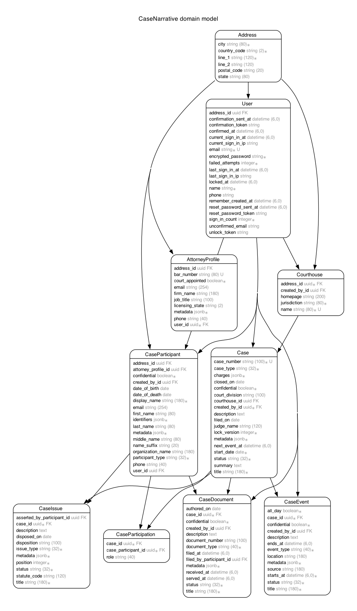

# README

[](https://github.com/overdrivemachines/case_narrative/actions/workflows/ci.yml)

CaseNarrative is a timeline-based application that helps defendants and attorneys document, organize, and understand events in a legal case. It presents a chronological narrative with supporting exhibits, allowing users to clearly reconstruct what happened and build a structured, evidence-backed case.


Live - https://casenarrative.com

# Model

Generated by Rails ERD. Run rails erd to regenerate (must have graphviz).


# Versions

- ruby 4.0.9
- Rails 8.1.4

# Deployment Requirements and Instructions

## Database

The production database runs on the VPS at `localhost:5432`. On Ubuntu 26.04, install PostgreSQL 18 and the client development library used by Ruby's `pg` gem:

```sh
sudo nala update
# Install required dependencies
sudo nala install -y curl ca-certificates gnupg
# Create a folder for the repository key
sudo install -d /etc/apt/keyrings
# Import the official PostgreSQL signing key
curl -fsSL https://www.postgresql.org/media/keys/ACCC4CF8.asc | sudo gpg --dearmor -o /etc/apt/keyrings/postgresql.gpg
# Add the repository configuration to your sources list
echo "deb [signed-by=/etc/apt/keyrings/postgresql.gpg] https://apt.postgresql.org/pub/repos/apt resolute-pgdg main" | sudo tee /etc/apt/sources.list.d/pgdg.list
sudo nala update
# Install PostgreSQL 18
sudo nala install postgresql-18 postgresql-client-18 libpq-dev
# Verify the installation
sudo systemctl status postgresql
psql --version
pg_lsclusters
```

Create a dedicated PostgreSQL role for this app. This role is separate from the Linux `deploy` account and should not be shared with other apps. Connect as the PostgreSQL administrator, create the login role, and set its password at the prompt:

```sh
sudo -u postgres psql
```

```sql
CREATE ROLE case_narrative LOGIN;
\password case_narrative

CREATE DATABASE case_narrative_production OWNER case_narrative;
CREATE DATABASE case_narrative_production_cache OWNER case_narrative;
CREATE DATABASE case_narrative_production_queue OWNER case_narrative;
CREATE DATABASE case_narrative_production_cable OWNER case_narrative;
```

# TODO

- Build core models (Case, Event, Exhibit)
- Implement timeline UI with dynamic data
- Add authentication (Devise)
- Add file uploads (Active Storage)
- Add rich text editor for narratives
- Add event linking and references
- Add export to PDF functionality
- Add gems:
  - gem "devise" # Authentication (users, attorneys, defendants)
  - gem "devise_invitable" # Invite users (attorney invites defendant)
  - gem "pundit" # Authorization (roles, permissions, access control)
  - gem "pg_search" # Full-text search using PostgreSQL
  - gem "validates_timeliness" # Validate dates and date ranges
  - gem "paper_trail" # Track changes (who edited what and when)
  - gem "bullet" # Detect N+1 queries
  - gem "rack-mini-profiler" # Performance profiling
  - gem "rspec-rails" # Testing framework
  - gem "factory_bot_rails" # Test data factories
  - gem "simplecov", require: false # Test coverage

# Dev: How To

## mise

This app uses [mise](https://mise.jdx.dev/) to manage Ruby, Node, and Bun versions. Update mise itself with `mise self-update` (or use the package manager that installed mise). Update tool versions in [`mise.toml`](mise.toml), then install them with:

```sh
mise install
```

## Package.json

### Update packages to latest versions

```sh
bun update --latest
```

### Run package scripts

Run these from the project root with `bun run <script>`:

| Command | What it does |
| --- | --- |
| `bun run build` | Builds the JavaScript assets. |
| `bun run lint` | Lints JavaScript with ESLint. |
| `bun run lint:css` | Lints CSS and SCSS with Stylelint. |
| `bun run lint:fix` | Lints and automatically fixes JavaScript, CSS, and SCSS where possible. |
| `bun run build:css` | Builds the CSS assets. |
| `bun run watch:css` | Rebuilds CSS when its source files change. |
| `bun run clean` | Removes generated JavaScript and CSS assets and source maps. |


# References
- Multi select dropdown
  - https://utilitybend.com/blog
  - multi-select-dropdown-js
    - https://codeshack.io/multi-select-dropdown-html-javascript/
    - https://github.com/codeshackio/multi-select-dropdown-js
  - https://preline.co/docs/components/advanced-select.html
  - https://github.com/brianvoe/slim-select
