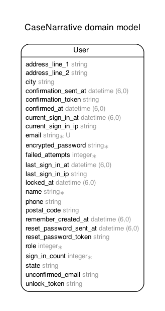

# Case Narrative

[](https://github.com/overdrivemachines/case_narrative/actions/workflows/ci.yml)

Case Narrative (casenarrative.com) helps people document events, organize evidence, build chronological timelines, and create clear, structured accounts of their cases. It brings fragmented memories, documents, communications, and supporting material into a coherent account of what happened.

## Who it is for

Case Narrative is primarily for individuals representing themselves or preparing information for attorneys. Examples include legal disputes, workplace incidents, insurance claims, and personal conflicts. After the individual experience is complete and validated, the app will expand to attorneys and law firms.

## Product principles

- **Evidence traceability:** preserve original material and connect important statements and events to their sources.
- **Factual accuracy:** distinguish allegations, source-supported statements, disputed accounts, uncertainty, and missing information. Supporting evidence does not automatically establish a statement as true.
- **Simplicity for non-lawyers:** make writing, collecting material, and reconstructing events approachable on desktop and mobile.
- **Private access:** keep cases and media private, with ownership checks from the MVP onward.

## Development roadmap

The following capabilities are planned work. Authentication and the Rails stack already exist; the checked-in schema currently contains only users.

### Milestone 1 — Narrative Editor & Media Uploads (MVP)

Create private cases with multiple narratives. Support creating, editing, saving, and deleting narratives, draft autosave, and a simple rich text toolbar with bold, italic, underline, and selected text at 1.3× normal size. Insert images and attach audio/video with inline playback for supported formats. Use Active Storage with private media access and responsive layouts.

Start with Action Text/Trix, verifying the required formatting and media behavior before building the full editor. Action Text and Active Storage are Rails components; `image_processing` and `ruby-vips` are already in the Gemfile. Add `aws-sdk-s3` only when configuring S3-compatible storage.

### Milestone 2 — Vertical Timeline & Narrative Integration

Build a vertical timeline with event titles, descriptions, and dates/times when known. Link events to narratives, allowing several events to reference the same narrative. Support adding, editing, deleting, and reordering events, including approximate and unknown dates without inventing precision. Keep dated events chronological and use manual ordering for ties and uncertain or undated events.

Use Rails, Turbo, Stimulus, and SCSS. No additional timeline or ordering dependency is needed initially.

**Launch a usable beta after milestone 2.** Prioritize reliable writing, saving, media uploads, and event reconstruction. Build milestones 3 and 4 based on feedback.

### Milestone 3 — Narrative & Timeline Enhancements

Add links to specific narrative sections, event-level media associations, source references, narrative search, tags or categories, printable narratives and timelines, and basic version history. Preserve rich text and attachment references when recording revisions.

Introduce `pg_search` for search and `paper_trail` for revision tracking when implementing those features. Start with print styles and browser save-to-PDF; add a PDF renderer only if automatic PDF downloads become necessary.

### Milestone 4 — AI Narrative Assistance

Add grammar and readability suggestions, summaries, proposed timeline events, and prompts about potentially conflicting statements or missing information. Let users select material for analysis and approve changes before they are saved. Preserve original statements and uncertainty, provide source references for suggested events, and prevent AI from inventing facts or deciding which disputed account is true.

Reuse existing background jobs with `solid_queue`. Consider `ruby_llm` only if an AI client is needed after reviewing any existing document-analyzer integration. Semantic search is outside the initial scope.

The [Case Narrative product plan](docs/product-plan.md) is the detailed source for milestone scope, completion criteria, architectural decisions, and dependency choices. Firm workspaces and professional collaboration workflows follow the completed individual experience.


Live - https://casenarrative.com

# Model

Generated by Rails ERD. Run rails erd to regenerate (must have graphviz).


# Versions

- ruby 4.0.9
- Rails 8.1.4

# Deployment Requirements and Instructions

## Database

The production database runs on the VPS at `localhost:5432`. On Ubuntu 26.04, install PostgreSQL 18 and the client development library used by Ruby's `pg` gem:

```sh
sudo nala update
# Install required dependencies
sudo nala install -y curl ca-certificates gnupg
# Create a folder for the repository key
sudo install -d /etc/apt/keyrings
# Import the official PostgreSQL signing key
curl -fsSL https://www.postgresql.org/media/keys/ACCC4CF8.asc | sudo gpg --dearmor -o /etc/apt/keyrings/postgresql.gpg
# Add the repository configuration to your sources list
echo "deb [signed-by=/etc/apt/keyrings/postgresql.gpg] https://apt.postgresql.org/pub/repos/apt resolute-pgdg main" | sudo tee /etc/apt/sources.list.d/pgdg.list
sudo nala update
# Install PostgreSQL 18
sudo nala install postgresql-18 postgresql-client-18 libpq-dev
# Verify the installation
sudo systemctl status postgresql
psql --version
pg_lsclusters
```

Create a dedicated PostgreSQL role for this app. This role is separate from the Linux `deploy` account and should not be shared with other apps. Connect as the PostgreSQL administrator, create the login role, and set its password at the prompt:

```sh
sudo -u postgres psql
```

```sql
CREATE ROLE case_narrative LOGIN;
\password case_narrative

CREATE DATABASE case_narrative_production OWNER case_narrative;
CREATE DATABASE case_narrative_production_cache OWNER case_narrative;
CREATE DATABASE case_narrative_production_queue OWNER case_narrative;
CREATE DATABASE case_narrative_production_cable OWNER case_narrative;
```

# Dev: How To

## mise

This app uses [mise](https://mise.jdx.dev/) to manage Ruby, Node, and Bun versions. Update mise itself with `mise self-update` (or use the package manager that installed mise). Update tool versions in [`mise.toml`](mise.toml), then install them with:

```sh
mise install
```

## Package.json

### Update packages to latest versions

```sh
bun update --latest
```

### Run package scripts

Run these from the project root with `bun run <script>`:

| Command | What it does |
| --- | --- |
| `bun run build` | Builds the JavaScript assets. |
| `bun run lint` | Lints JavaScript with ESLint. |
| `bun run lint:css` | Lints CSS and SCSS with Stylelint. |
| `bun run lint:fix` | Lints and automatically fixes JavaScript, CSS, and SCSS where possible. |
| `bun run build:css` | Builds the CSS assets. |
| `bun run watch:css` | Rebuilds CSS when its source files change. |
| `bun run clean` | Removes generated JavaScript and CSS assets and source maps. |


# References
- Multi select dropdown
  - https://utilitybend.com/blog
  - multi-select-dropdown-js
    - https://codeshack.io/multi-select-dropdown-html-javascript/
    - https://github.com/codeshackio/multi-select-dropdown-js
  - https://preline.co/docs/components/advanced-select.html
  - https://github.com/brianvoe/slim-select
